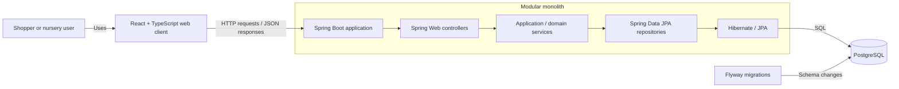

# GreenLeaf Nursery Architecture

## Purpose

This document describes the intended architecture for GreenLeaf Nursery, a full-stack plant nursery ecommerce application. It is a design baseline for the guided learning project, not a claim that these components have already been implemented. The goal is to make responsibilities and request flow explicit while keeping the initial system small enough to understand and operate.

## Application architecture

GreenLeaf Nursery is planned as a modular monolith: one deployable backend application with clear internal responsibility boundaries, a separately built React web client, and a PostgreSQL database. The backend owns business rules and persistence access. The browser client presents the experience and calls the backend over HTTP. PostgreSQL is the durable relational store.

The initial backend can be organized around the plant/catalog and care-guide concepts, with cart and inventory capabilities added in their appropriate modules as those features are implemented. These are logical boundaries within the application, not separate services or deployments. Exact package boundaries and API endpoints remain implementation decisions.

## Component responsibilities

### Frontend: React, TypeScript, Vite, Tailwind CSS

- Render the plant browsing, search/filter, plant-detail, and shopping-cart user experiences as those capabilities are implemented.
- Collect user input and make HTTP requests to the backend; display returned data and useful request or validation feedback.
- Use TypeScript types at the client boundary to make expected request and response shapes clearer. These types do not replace backend validation or domain rules.
- Use Vite for the frontend development/build workflow and Tailwind CSS for styling.
- Avoid treating client state as authoritative for prices, stock, or other business decisions; the backend remains responsible for validating those values.

### Backend: Java 25 and Spring Boot

- Expose the application’s HTTP API using Spring Web controllers.
- Apply application and domain rules in services, including validation of operations against current persisted state.
- Use Spring Data JPA and Hibernate to map domain persistence to PostgreSQL, with repositories isolating data access.
- Use Spring Security as the security framework. Authentication mechanisms, roles, and authorization policy have not yet been specified and should be decided when a protected capability is designed.
- Use Flyway to manage versioned database schema changes.
- Keep feature responsibilities separated inside the monolith so that modules can evolve without introducing network calls between them.
- Organize the backend as feature-oriented modules such as `plant`, `inventory`, `cart`, and `order`. Each module may contain its own controller, service, repository, and domain classes. This proposed package organization preserves business capability boundaries while maintaining a layered architecture inside each module; it is a design proposal, not implemented code.

### Database: PostgreSQL

- Persist the application’s relational data, initially including plant/catalog data and its care requirements.
- Enforce suitable relational constraints and indexes as the actual query and data-integrity needs become clear.
- Receive schema changes through Flyway migrations rather than relying on ad hoc production schema edits.
- Run locally in Docker for a reproducible development database environment. This does not prescribe a production hosting arrangement.

## Request flow: React to PostgreSQL

The following is the proposed flow for a read such as browsing or viewing a plant. Exact routes and payload formats are not yet defined.

1. A user interacts with the React interface, which sends an HTTP request to the Spring Boot API.
2. A Spring Web controller receives the request, binds input, and delegates to an application service. The controller handles the HTTP boundary; it should not contain core business rules or direct persistence logic.
3. The service applies the relevant use-case logic and calls a repository when persisted data is needed.
4. A Spring Data JPA repository uses Hibernate/JPA to issue SQL against PostgreSQL.
5. The result returns through the repository and service. The controller maps the result to an HTTP response, and the frontend renders it.

For a future write operation, the same layers apply: validate the request at the boundary, enforce business invariants in the service/domain logic, persist through a repository, and return an appropriate response. Transaction boundaries should be placed around service-level operations that must succeed or fail together.

## Backend responsibility boundaries

- **Controller:** HTTP routing, request/response binding, boundary-level validation and status mapping, and delegation to a service. Keep business rules and database queries out of controllers.
- **Service:** Coordinates a use case, applies business rules, and establishes transaction boundaries where needed. It calls repositories rather than exposing persistence concerns to the web layer.
- **Repository:** Provides persistence operations for the domain/application layer using Spring Data JPA. It should not become the owner of application workflows or HTTP behavior.

These boundaries are proposed guidance for the implementation; they do not require a particular package naming convention.

## Proposed domain model

### Plant

The initial `Plant` model includes the fields supplied for the project:

| Field | Initial role |
|---|---|
| `id` | Identifier for a plant record; concrete type and generation strategy are implementation choices. |
| `name` | Common/display name. |
| `botanicalName` | Botanical name. |
| `description` | Descriptive plant information. |
| `category` | Plant category; representation and allowed values remain to be defined. |
| `price` | Product price; currency and precision conventions remain to be defined. |
| `stockQuantity` | Available inventory quantity. |
| `imageUrl` | Reference to a plant image. Image storage and validation are not specified yet. |
| `active` | Whether the plant is active in the catalog. |
| `careRequirements` | Embedded `PlantCareRequirements` value object. |

### PlantCareRequirements

Initially, `PlantCareRequirements` is an embedded value object owned by a `Plant`, with no separate lifecycle specified. Its fields are `wateringMinDays`, `wateringMaxDays`, `sunlightRequirement`, `humidityMinPercent`, `humidityMaxPercent`, `wateringNotes`, and `careInstructions`. `sunlightRequirement` uses an enum. The exact enum values, bounds, units, and validation rules should be decided with the implementation rather than assumed here.

This shape supports the initial care-guide capability. If seasonal schedules or regional recommendations are introduced later, revisit whether the care data still fits naturally as one embedded value or needs a richer relational model.

## Testing strategy (proposed)

Testing should grow alongside each feature rather than precede the application as a large speculative suite:

- **Backend unit tests:** Verify service/domain rules in isolation, including plant and care requirement validation once those rules are defined.
- **Backend persistence/integration tests:** Exercise Spring/JPA behavior and Flyway migrations against PostgreSQL-compatible test infrastructure so mapping and schema behavior are covered.
- **API tests:** Verify controller request/response behavior and validation at the HTTP boundary.
- **Frontend tests:** Cover user-visible behavior for browsing, filtering, plant details, and cart flows as those interfaces are built.
- **End-to-end tests:** Add a small number of critical user journeys when a runnable full stack exists.

The exact libraries, coverage targets, and test execution environment are open implementation decisions.

## CI/CD strategy (proposed)

Use GitHub Actions to automate repeatable checks on repository changes. A practical staged approach is to build and run relevant backend and frontend checks first, then build Docker images or a Compose-based verification environment as the project needs mature. Keep schema migration validation in the backend/database checks. Deployment targets, environments, secrets handling, release approvals, and cloud provider are not specified, so this document does not prescribe them.

Docker Compose can be used for local multi-component development, including the PostgreSQL container and, when useful, the application services. The initial explicit decision is to use Docker for PostgreSQL; other Compose services can be added as implementation needs become concrete.

## Future architectural considerations

- Reassess the embedded care model if seasonal schedules or regional recommendations are introduced.
- Define API contracts, validation rules, currency handling, category representation, and image lifecycle when implementing the corresponding workflows.
- Determine authentication and authorization needs before exposing protected inventory management operations; Spring Security is selected, but policy is not specified.
- Review transaction and concurrency behavior for stock updates and cart operations as those use cases are designed.
- Add indexes based on observed search/filter queries and data volume rather than guessing prematurely.
- Choose deployment topology and operational practices when a cloud target is selected. The modular monolith can remain the deployment unit while internal boundaries are refined.

